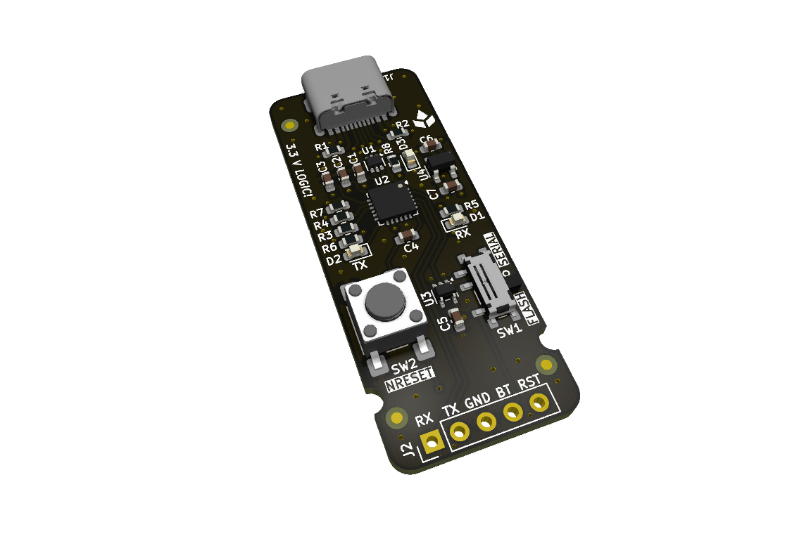
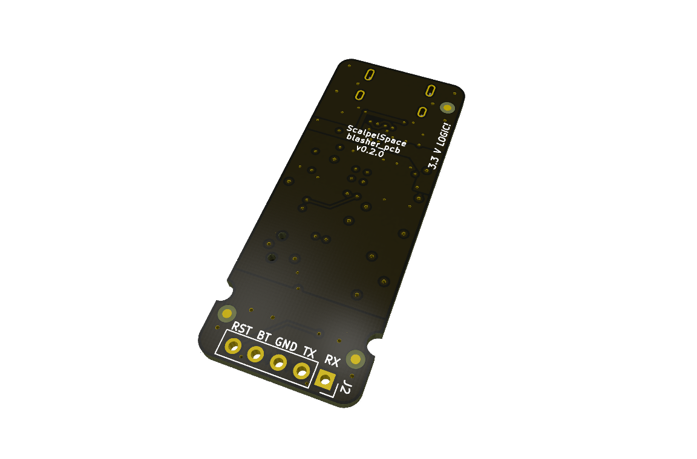

<!-- Text above the details marker is the short "Overview" near the top of
     the datasheet. Text below it becomes the "Detailed description" section,
     placed just before "Firmware and software". The shared product
     description comes from _data/products/blasher/product.yml. -->

Rel A corresponds to `blasher_pcb` v0.2.0, a 4-layer board.

<!-- Board top and bottom, side by side. -->

  <figure>
    
    <figcaption>Top</figcaption>
  </figure>
  <figure>
    
    <figcaption>Bottom</figcaption>
  </figure>

<!-- details -->

### Blasher web app

The main tool for Blasher is the web app at
[blasher.scalpelspace.com](https://blasher.scalpelspace.com). It runs in the
browser and talks to the board over its USB serial port, with two functions:

- **Firmware flash:** drop in a `.bin` image for hands-free flashing over the
  target's STM32 UART bootloader, with options to mass erase first, verify
  after write and run the application when done.
- **Serial monitor:** a simple serial terminal for quick debugging.

Blasher does not power the target. The target must be powered separately.

### USB interface via CP2102N

The USB interface uses a CP2102N USB-to-UART bridge, which requires Silicon
Labs's
[CP210x USB to UART Bridge VCP Drivers](https://www.silabs.com/developer-tools/usb-to-uart-bridge-vcp-drivers)
on the host.
