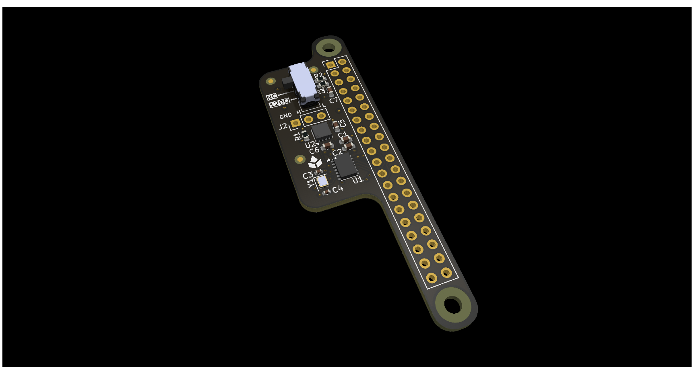
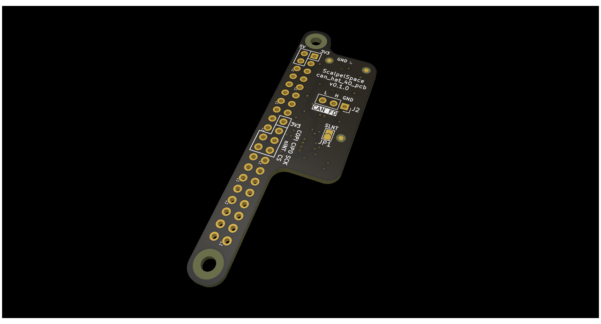

<!-- Text above the details marker is the short "Overview" near the top of
     the datasheet. Text below it becomes the "Detailed description" section,
     placed just before "Firmware and software". The shared product
     description comes from _data/products/can_hat_40/product.yml. -->

Rel A corresponds to `can_hat_40_pcb` v0.1.0, a 4-layer board.

<!-- Board top and bottom, side by side. -->

  <figure>
    
    <figcaption>Top</figcaption>
  </figure>
  <figure>
    
    <figcaption>Bottom</figcaption>
  </figure>

<!-- details -->

### Host interface

The hat bridges the host's SPI bus to the CAN bus through the MCP2518FD
controller. By default it uses the host's SPI0 bus (CE0) with the controller
interrupt on GPIO22, which matches the device-tree overlay shown in the Linux
setup guide.

The board operates at fixed 3.3 V logic.

### Bus termination

The `CAN termination` switch (SW1) connects a 120 Ohm split termination (2x 60
Ohm with a centre-tap capacitor) across the bus. The switch positions
are marked `120` (terminated) and `NC` (not terminated).

Enable termination only when the board sits at a physical end of the bus.

### Silent mode

Closing the `CAN silent` jumper (JP1) puts the transceiver in silent
(listen-only) mode, for monitoring a bus without transmitting on it.
