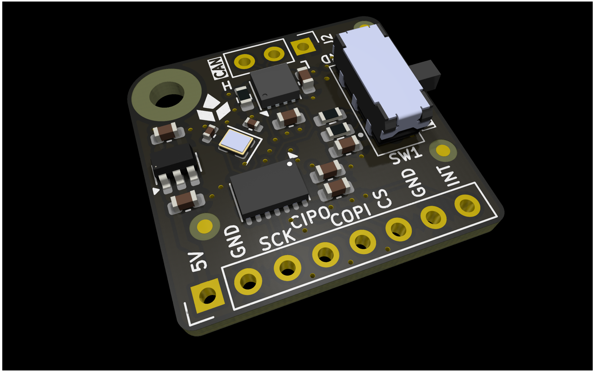
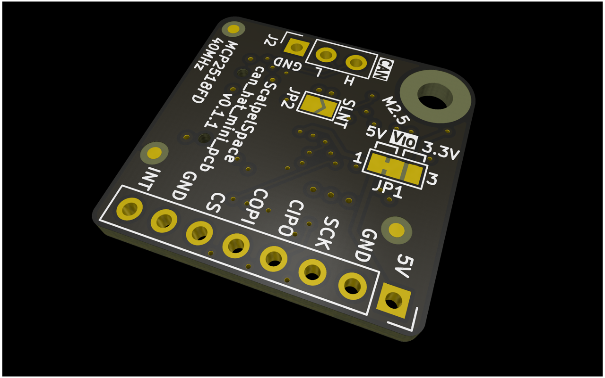

<!-- Text above the details marker is the short "Overview" near the top of
     the datasheet. Text below it becomes the "Detailed description" section,
     placed just before "Firmware and software". The shared product
     description comes from _data/products/can_hat_mini/product.yml. -->

Rel A corresponds to `can_hat_mini_pcb` v0.1.1.

<!-- Board top and bottom, side by side. -->

  <figure>
    
    <figcaption>Top</figcaption>
  </figure>
  <figure>
    
    <figcaption>Bottom</figcaption>
  </figure>

<!-- details -->

### Host interface

The 8-pin header (J1) carries 5 V power, ground and the SPI lines (`SCK`,
`CIPO`, `COPI` and `CS`) of the MCP2518FD controller. The second ground pin
is optional.

The interrupt pin (`INT`) is optional but recommended. It should be attached
to a hardware interrupt pin on the host.

### Logic level

The `V IO` jumper (JP1) selects the logic level of the host interface: 5 V
(default) or 3.3 V. Set it to match the host.

### Bus termination

The `CAN termination` switch (SW1) connects a 120 Ohm split termination (2x 60
Ohm with a centre-tap capacitor) across the bus. The switch positions
are marked `120` (terminated) and `NC` (not terminated).

Enable termination only when the board sits at a physical end of the bus.

### Silent mode

Closing the `CAN silent` jumper (JP2) puts the transceiver in silent
(listen-only) mode, for monitoring a bus without transmitting on it.
