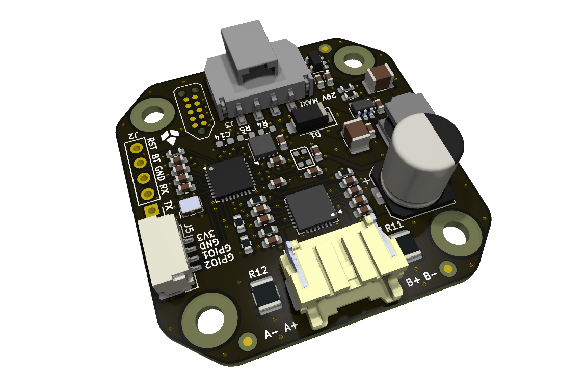
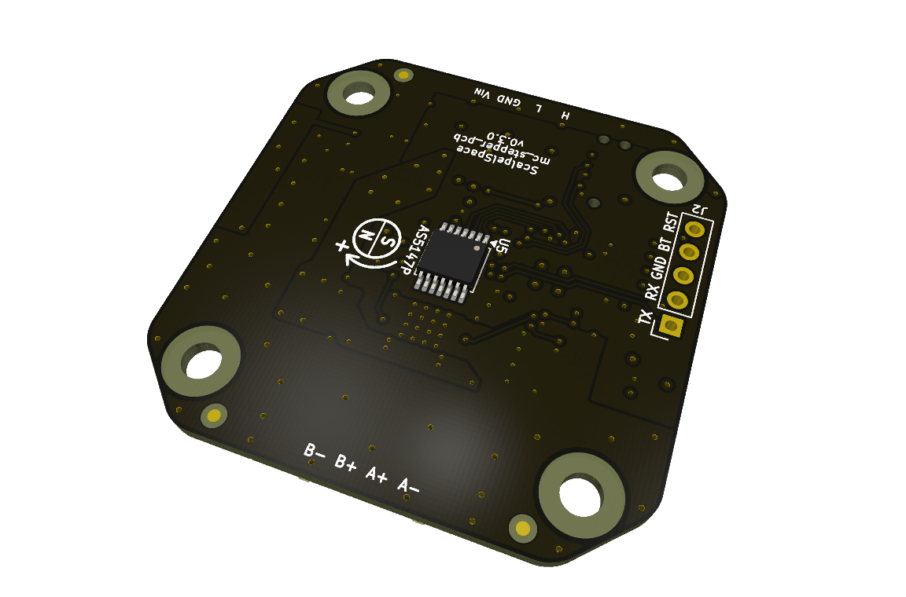

<!-- Text above the details marker is the short "Overview" near the top of
     the datasheet. Text below it becomes the "Detailed description" section,
     placed just before "Firmware and software". The shared product
     description comes from _data/products/mc_stepper/product.yml. -->

Rel A corresponds to `mc_stepper_pcb` v0.3.0, a 4-layer board.

<!-- Board top and bottom, side by side. -->

  <figure>
    
    <figcaption>Top</figcaption>
  </figure>
  <figure>
    
    <figcaption>Bottom</figcaption>
  </figure>

<!-- details -->

### Power supply

The board is powered through the `Power and CAN` connector (J3). The maximum
input voltage is 29 V, limited by the absolute maximum supply rating of the
TMC2209. Operating below this limit (28 V or less) is recommended for margin.

### GPIO connector

The `GPIO` connector (J5) is intended for custom hardware connections. The
3.3 V pin is supplied by the onboard TLV77333PDBVR LDO (300 mA maximum).
Onboard circuitry is budgeted at 100 mA, leaving approximately 200 mA available
for external hardware. Actual available current may be limited by LDO thermal
dissipation, depending on input voltage and ambient temperature.

### On-board CAN termination

R4, R5 and C14 are not populated by default. They are reserved for optional
on-board split termination: two 60 Ohm resistors with a 4.7 nF capacitor from
their midpoint to ground.

Populate these components only when the board sits at a physical end of the
CAN bus.

### STM32L432KC flashing

The STM32L432KC can be flashed in two ways:

1. SWD via the Tag-Connect TC2050 connector (J1).
2. UART bootloader via the `UART breakout` connector (J2): assert `BOOT0`
   (pin 4) high and pulse `NRESET` (pin 5) to enter the bootloader.
