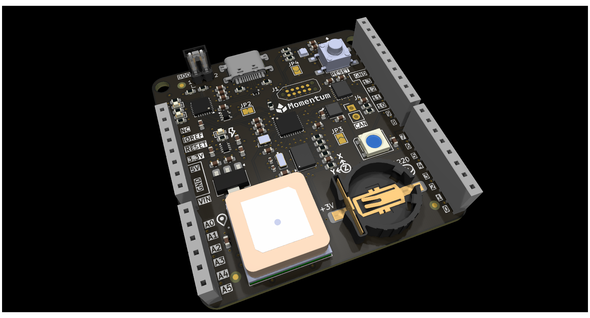
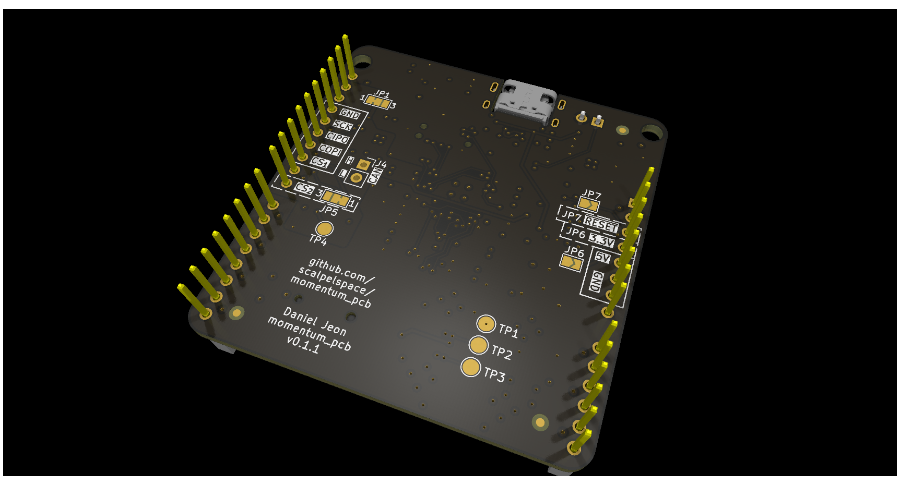

<!-- Text above the details marker is the short "Overview" near the top of
     the datasheet. Text below it becomes the "Detailed description" section,
     placed just before "Firmware and software". The shared product
     description comes from _data/products/momentum/product.yml. -->

Rel A corresponds to `momentum_pcb` v0.1.1, a 4-layer board built around the
BNO085 IMU.

<!-- Board top and bottom, side by side. -->

  <figure>
    
    <figcaption>Top</figcaption>
  </figure>
  <figure>
    
    <figcaption>Bottom</figcaption>
  </figure>

<!-- details -->

### Power supply

The board can be powered by either of the following methods:

1. `5V` pin via the Uno-style interface.
2. Onboard USB-C connector.

The 5 V supply is managed by an OR power switch (TPS2116DRL). The `5V` pin
from the Uno-style interface takes priority: as long as ~1 V or more is present
on this pin, it is used as the power source. Otherwise the board automatically
switches to the USB-C 5 V supply.

The 3.3 V supply is managed onboard by a dedicated 5 V to 3.3 V LDO,
independent of any connected board.

To use the board's 3.3 V supply for low current applications, bridge the
`Interface 3.3 V output` jumper (JP6). This connects the onboard LDO to the
Uno-style interface `3.3V` pin. Use with caution: a connected main controller
usually supplies its own 3.3 V on the same pin.

### SPI interface

All SPI pins interfacing with connected boards are level shifted. By default
the external SPI pins are shifted to 5 V. They can be shifted to 3.3 V instead
with the `Level shifter V IO` 3-pad jumper (JP1).

The SPI CS pin can be swapped between the Uno-style interface pins `D10`
(default) and `D8` with the `Interface SPI CS pin select` jumper (JP5). This
is intended to help resolve pin conflicts.

### STM32L432KC flashing

The STM32L432KC can be flashed in 3 different ways:

1. SWD via the Tag-Connect TC2050 interface (J1).
2. Hands-free UART bootloader via USB-C (CP2102N USB-to-UART).
3. Manual BOOT0 jumper with UART bootloader via USB-C (CP2102N USB-to-UART).

For the USB-C UART bootloader interface, the flashing software
[pyblasher](https://github.com/scalpelspace/pyblasher) is highly recommended.

All three options are available by default, however **options 1 and 2 are
suggested**.

Option 3 applies when USB-C is used as both a serial and a UART bootloader
interface. In this method the through-hole `BOOT0 jumper` (J2) must be
manually bridged to assert BOOT0. See *USB-C serial interface* below.

### USB-C serial interface

The USB-C interface, connected through the CP2102N USB-to-UART bridge, is
primarily a UART bootloader flashing interface. It can also be used as a
serial interface for simple communication with a desktop computer.

Because of the hands-free flashing design, the STM32's BOOT0 is controlled by
the CP2102N's DTR pin. When a COM port is established, BOOT0 is raised high
and the MCU enters the bootloader. To prevent this, cut the `BOOT0 DTR bridge`
jumper (JP2), which allows USB-C serial communication.

With this modification the UART bootloader can still be used, but BOOT0 must
be asserted manually with the through-hole `BOOT0 jumper` (J2).
